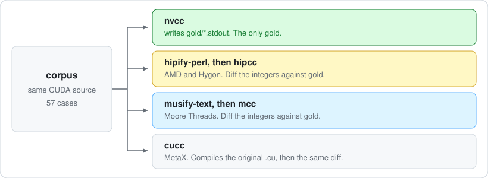

# cuda-census

The same CUDA source, compiled and run by each vendor's own tools, then diffed against `nvcc`. This repository is not a converter.

[](LICENSE)
[](gold/provenance.json)
[](toolchains.json)

[cuda-retarget](https://github.com/Tes-bo/cuda-retarget) is a separate rewriter. It is not a column in this table. A path whose name is `cuda-retarget` is refused.

<p align="center">
  
</p>

**Quick start · [Statuses](#statuses) · [Corpus](#corpus) · [Run](#run)**

A green cell means that vendor's tool compiled the case, ran it, and printed the same integers as the committed `nvcc` stdout. Vendor results are not compared with each other.

cuda-census is not affiliated with NVIDIA, AMD, Hygon, Moore Threads, or MetaX. CUDA names the source language. The vendor names name the official tools under test.

## Quick start

Python 3.10 or newer.

```bash
python3 -m census self-check
python3 -m census list
python3 -m census run --toolchain nvcc
python3 -m census run --toolchain hipify
python3 -m census run --toolchain musify
python3 -m census run --toolchain cu-bridge
python3 -m census report
```

`run` exits 0 when every selected case is `pass`. It exits 2 when the only failures are missing tools. Any compile, run, or numeric failure exits 1. `--case <id>` runs one case. `--timeout <seconds>` limits each translate, compile, and run step (default 120).

Each case prints `name=integer` lines and nothing else. The runner writes `results/<toolchain>/<case>.json`, which follows `schema/result.schema.json`. Paths inside the checkout are written relative to it. `results/` is not committed.

`report` prints `results/` as one Markdown table with a column per toolchain, then lists every mismatched key. Each result records the SHA-256 of the case source and of the gold it was compared with. A cell is marked `(stale)` when either file changed after the run, and stale cells are not counted as passes. `--toolchain` picks columns. `--output` writes the table to a file.

`self-check` needs no GPU. It checks that every corpus directory, manifest entry, gold file, and `gold/provenance.json` entry agree, that `toolchains.json` only uses known keys and slots, that the schema matches the runner, and that the corpus table below and `docs/overview.svg` show the manifest's cases and integers.

## Statuses

| Status | Meaning |
| --- | --- |
| `pass` | The program ran and its integers match `gold/<case>.stdout`. |
| `numeric-mismatch` | The program ran and at least one integer differs from gold. The diff is actual minus gold. A key that only one side printed has the diff `null`. |
| `compile-fail` | Translate or compile returned non-zero, or ran past the timeout. |
| `run-fail` | The binary returned non-zero, or ran past the timeout (`returncode` is `null`). |
| `unparsed-stdout` | Stdout was not a set of `name=integer` lines. |
| `gold-missing` | A vendor toolchain ran, but `gold/` has no `nvcc` stdout for that case. |
| `toolchain-missing` | One of the official tools for that toolchain is not on `PATH`. All tools are looked up before any step runs. |

`nvcc` itself is compared with the `expect` integers in `corpus/manifest.json`. Vendors are compared with the committed `gold/` stdout.

Every case checks `cudaGetLastError()` after its launches. A kernel that fails to launch, for example because it was built for the wrong architecture, exits non-zero and is reported as `run-fail`, not as a row of zeros.

`gold/` is produced only by `nvcc`. `--write-gold` is rejected for every other toolchain.

The committed gold was produced by CUDA 12.0 (`Cuda compilation tools, release 12.0, V12.0.140`) on a Tesla V100-SXM2-32GB. `gold/provenance.json` records that run. HIPIFY, musify, and cu-bridge are wired in `toolchains.json` and were not executed in this tree, because those tools are not installed here. A machine that has them should run the same command and publish the JSON.

## Corpus

66 cases. The gold column is the `nvcc` stdout.

| Case | What it exercises | Gold |
| --- | --- | --- |
| `vector_add_int` | Runtime API, launch, device memcpy | `sum=8256` |
| `warp_shuffle` | `__shfl_sync` across one warp | `sum=160` |
| `warp_size` | the `warpSize` builtin | `width=32` |
| `match_any` | `__match_any_sync` / `__match_all_sync` across two warps | `lane0=1`, `lane32=1`, `all=0`, `pred=0` |
| `warp_vote` | `__ballot_sync`, `__any_sync`, `__all_sync`, `__uni_sync` across two warps | `lane0=4294967295`, `any0=1`, `all0=1`, `uni0=1`, `lane32=0`, `any32=0`, `all32=0`, `uni32=1` |
| `warp_reduce` | `__shfl_xor_sync` butterfly in each of two warps | `lane0=496`, `lane32=1520` |
| `syncwarp` | no-argument `__syncwarp()` then a shared-memory sum | `sum=496` |
| `shared_atomic` | `atomicAdd` on shared memory | `total=128` |
| `double_as_longlong` | `__double_as_longlong(1.0)` | `bits=4607182418800017408` |
| `double_hi_lo` | `__double2hiint` / `__double2loint` / `__hiloint2double` of 1.0 | `hi=1072693248`, `lo=0`, `round=1` |
| `float_as_int` | `__float_as_int(1.0f)` | `bits=1065353216` |
| `funnelshift` | `__funnelshift_l` / `_lc` / `_r` / `_rc` wrap versus clamp | `l1=2021161081`, `l32=1010580540`, `lc32=2779096485`, `r1=1389548242`, `rc32=1010580540` |
| `dp4a` | signed and unsigned `__dp4a` four-byte dot products | `ones=4`, `s=2`, `s80=-512`, `u=258`, `u80=512` |
| `packed_add` | `__vadd2` / `__vsub2` / `__vadd4` / `__vsub4`, wrap versus signed and unsigned saturation | `add2=2147483648`, `addss2=2147418112`, `addus2=2147549183`, `subss2=2147549183`, `add4=2147647744`, `addss4=2130870528`, `addus4=2147647999` |
| `packed_minmax` | `__vmins2` / `__vminu2` / `__vmaxs2` / `__vmaxu2` and the 4-byte forms | `mins2=2147483648`, `minu2=2147418112`, `maxs2=2147418113`, `maxu2=2147483649`, `mins4=2147581952`, `minu4=2130804480` |
| `packed_abs` | per-lane abs, negation, and signed versus unsigned absolute difference | `abs2=2147483650`, `absss2=2147418114`, `neg2=2147549182`, `negss2=2147549182`, `negss4=2147451263`, `diffs2=2147483650`, `diffu2=2147549182` |
| `byte_perm` | `__byte_perm` byte select; high selector bits are ignored | `id=2712847316`, `fromy=523124044`, `high=523124044`, `nibble=3569595041`, `zero=3570717908` |
| `average` | `__hadd` / `__rhadd` / `__uhadd`, rounding and overflow | `h12=1`, `r12=2`, `hneg=-3`, `rneg=-2`, `hmin=-2147483648`, `uhwrap=2147483648` |
| `mulhi` | high half of a signed or unsigned product, 32-bit and 64-bit | `min1=-1`, `minneg=0`, `minsq=1073741824`, `umax=4294967294`, `neg64=-1`, `sq64=4611686018427387904`, `umax64=18446744073709551614` |
| `sad` | `__sad` / `__usad`, widened absolute difference plus a wrapping add | `sneg=2`, `smin=2147483648`, `smin1=2147483649`, `swrap=0`, `umax=4294967295`, `uwrap=0` |
| `packed_sad` | sum of per-lane absolute differences, signed versus unsigned | `s2=2`, `u2=65536`, `smin=65536`, `pair=3`, `s4=131`, `u4=639` |
| `packed_cmp` | per-lane comparison masks, signed versus unsigned | `eq=4294901760`, `ne=65535`, `gts=65535`, `gtu=4294967295`, `lts=4294901760`, `gts4=255` |
| `packed_set` | per-lane predicates of 1, not an all-ones mask | `eq=65536`, `ne=1`, `gts=1`, `gtu=65537`, `gts4=1`, `gtu4=16777473` |
| `packed_avg` | packed averages, round-half-away-from-zero versus truncation | `spos=131074`, `sneg=4294836221`, `smin=2147516416`, `uround=131074`, `uplain=65537`, `uhalf=2147516416` |
| `bit_scan` | leading zeros, first set bit, population count, and bit reverse | `clz0=32`, `clzmin=0`, `ffs0=0`, `ffsmin=32`, `brev1=2147483648`, `clzll0=64`, `popc=32`, `brevll=9223372036854775808` |
| `mul24` | 24-bit product, high byte ignored, low 32 bits kept | `hi=2`, `sign=-8388608`, `neg1=1`, `sq=0`, `usq=4261412865`, `uhi=16777216` |
| `round_cvt` | float and 32-bit integer conversions, ties and saturation | `rn25=2`, `ru25=3`, `rdn=-3`, `big=2147483647`, `nan=0`, `ubig=4294967295`, `up=1266679809`, `nrd=3414163458` |
| `round_wide` | 64-bit and double conversions; NaN is the high bit | `llnan=-9223372036854775808`, `llbig=9223372036854775807`, `ullnan=9223372036854775808`, `llru=1509949441`, `dnan=-2147483648`, `dtrunc=1`, `dull=18446744073709551615` |
| `saturatef` | clamp to [0, 1]; NaN and negative zero become +0 | `neg=0`, `two=1065353216`, `half=1056964608`, `mzero=0`, `nan=0` |
| `farith` | directed float add, sub, mul, and fused multiply-add | `addru=1065353217`, `zrd=2147483648`, `zsame=0`, `addmax=2139095039`, `fmacancel=679477248`, `fmanan=2147483647` |
| `dround` | double to float and to integers, with a chosen rounding mode | `ftie=1065353216`, `ftru=1065353217`, `fsubru=1`, `fmax=2139095039`, `fnan=4290772992`, `fru=1266679809`, `inan=-2147483648` |
| `half_cvt` | float to half and half back to float | `halftie=15360`, `halfru=15361`, `halfsubru=1`, `halfmax=31743`, `halfnan=32767`, `halfmzero=32768`, `fnan=2147483647`, `finf=4286578688` |
| `half_wide` | integers and doubles into half | `i2049=26624`, `i2049ru=26625`, `i65520rz=31743`, `n65519=64511`, `dabove=1`, `dvia=0`, `dnan=32767` |
| `half_int` | half to integers, with a chosen rounding mode | `i15rn=2`, `i15rz=1`, `i32=32768`, `s32=32767`, `sneg=-32768`, `usinf=65535`, `nan=0`, `llnan=9223372036854775808` |
| `harith` | half add, multiply, fused multiply-add, and saturate | `zpn=0`, `znn=32768`, `nan=32767`, `overflow=31744`, `cancel=0`, `residual=16`, `sat3=15360`, `satnan=0` |
| `half2` | packed half2 lanes, the low lane in the low 16 bits | `nanlo=1073774591`, `residual=16`, `cancel=0`, `split=2080390144`, `satnan=1006632960` |
| `hcmp` | half ordered and unordered compares, max, and sign | `nenan=0`, `equnan=1`, `eq2=15360`, `eqmask=65535`, `min0=32768`, `negnan=32767` |
| `darith` | directed double add, sub, mul, and fused multiply-add | `zrd=9223372036854775808`, `addmax=9218868437227405311`, `nan2=9221120237041090562`, `mulnan=18444492273895866368`, `residual=4138808057553485824`, `subtie=4607182418800017407` |
| `ddiv` | directed double division, reciprocal, and square root | `dnan0=18444492273895866368`, `dnan2=9221120237041090565`, `d3ru=4599676419421066582`, `dunru=1`, `dovrd=9218868437227405311`, `ds2rd=4609047870845172684`, `rsubrz=9218868437227405311` |
| `fdiv` | directed float division, reciprocal, square root, and reciprocal square root | `divnan=2147483647`, `sq2ru=1068827892`, `d3rz=1051372202`, `underru=1`, `ovrd=2139095039`, `rsqrt=1392508928`, `split=1392508929` |
| `fminmax` | min, max, nextafter, and copysign | `minzm=2147483648`, `maxzm=0`, `minnan=2147483647`, `nxtzm=2147483648`, `copynan=4290772993`, `dminnan=9221120237041090565`, `dnxtone=9221120237041090561` |
| `ptx` | inline `lop3.b32`, `bfe`, `bfi`, and `prmt.b32` | `lop=2273806215`, `lopz=0`, `sbit=4294967295`, `spos=4294967295`, `s0=0`, `psign=16843008`, `pbyte=16843009` |
| `i2d` | integer to double, with a chosen rounding mode | `tie=4845873199050653696`, `tieru=4845873199050653697`, `tie3=4845873199050653698`, `ntierd=14069245235905429505`, `ullrz=4895412794951729151`, `imin=13970166044103278592` |
| `fround` | `floor`, `ceil`, `trunc`, `rint`, `nearbyint`, and `round` | `rhalf=0`, `ohalf=1065353216`, `r25=1073741824`, `o25=1077936128`, `fnan=2147483647`, `dnan=9221120237041090561` |
| `fsplit` | `frexp`, `ilogb`, `modf`, `ldexp`, `fmod`, `remainder`, and `fdim` | `fexp=-148`, `ilog0=-2147483648`, `r7=3212836864`, `f7=1065353216`, `fd0=0`, `dinv=18444492273895866368` |
| `lround` | `lrint`, `lround`, `llrint`, and `llround` | `ohalf=1`, `rhalf=0`, `p31=2147483648`, `fnan=-9223372036854775808`, `dlo=2251799813685249`, `d63=9223372036854775807` |
| `hypot` | `hypotf`, `norm3df`, and `norm4df` | `infnan=2139095040`, `big=1605698803`, `naive=2139095040`, `n4=1610612736`, `nann=2147483647` |
| `remquo` | `remquo` and `remquof` | `q7=4`, `q15=0`, `q15one=7`, `qn=-4`, `qodd=0`, `dinv=18444492273895866368` |
| `scale` | `logb`, `scalbn`, and `scalbln` | `z=4286578688`, `sub=3272933376`, `shuge=2139095040`, `slow=4194304`, `dsig=9221120237041090561` |
| `abs` | `abs`, `labs`, `llabs`, `fabsf`, and `fabs` | `amin=-2147483648`, `along=2147483648`, `llmin=-9223372036854775808`, `fnan=2147483647`, `ndnan=18444492273895866369` |
| `fpred` | `signbit`, `isnan`, `isinf`, and `isfinite` | `sb0=0`, `sbm=1`, `sbn=1`, `nsig=1`, `inan=0`, `fsub=1`, `ininf=1` |
| `dp2a` | `__dp2a_lo` and `__dp2a_hi` | `slo=4194176`, `ulo=4194432`, `zlo=0`, `sff=-1`, `uff=255`, `wrap=-2147483647` |
| `fns` | `__fns` | `none=4294967295`, `up=1`, `down=1`, `bhi=4294967295`, `imin=0` |
| `sqrt` | `sqrtf` and `sqrt` | `fm0=2147483648`, `fneg=2147483647`, `fsub=439682291`, `dneg=18444492273895866368`, `ndsig=18444492273895866369` |
| `fma` | `fmaf` and `fma` | `gap=679477248`, `split=0`, `zm0=2147483648`, `dgap=4138808057553485824`, `dinf0=18444492273895866368` |
| `global_atomic` | global `atomicAdd` / `Sub` / `Min` / `Max` / `Inc` / `Dec` / `And` / `Or` / `Xor` / `Exch` / `CAS`, 32-bit, 64-bit, float, and double, from 256 threads | `inc=6`, `dec=4`, `xor=85`, `umax=4294967251`, `u64wrap=240`, `fadd=1124073472` |
| `symbols` | `__constant__` and `__device__` symbols through `cudaMemcpyToSymbol` / `FromSymbol` at an offset, `cudaGetSymbolAddress`, and `cudaGetSymbolSize` | `t4=3000`, `counter=18`, `fifth=-32`, `size=32` |
| `dynamic_shared` | 64 KiB of `extern __shared__` after the `cudaFuncSetAttribute` opt-in, and one buffer carved into int and double regions | `optin=65536`, `total=2605056`, `weighted=106345728`, `carved=41664` |
| `managed` | `cudaMallocManaged` and `__managed__` used by host and device with no copy, and `cudaPointerGetAttributes` | `sum=1000000`, `again=-998000`, `bumps=2005`, `ismanaged=1` |
| `stream_order` | an event orders two non-blocking streams, then `cudaMemcpyAsync` to pinned memory and `cudaLaunchHostFunc` | `sum=32896`, `hostfn=42`, `eventdone=1` |
| `coop_groups` | cooperative-groups tiles of 32 and 16, `cg::reduce`, a tile ballot, and `coalesced_threads` across two warps | `tile1=376`, `warp1=1520`, `ballot=1431655765`, `csize=11`, `csum=165` |
| `grid_sync` | `cudaLaunchCooperativeKernel` and `grid.sync()` across 8 blocks | `sum=524800`, `moved=1024`, `size=1024` |
| `wmma` | one 16x16x16 `wmma` half multiply into a float accumulator | `c00=12`, `trace=62`, `weighted=36182`, `colmajor=256` |
| `device_printf` | kernel `printf` of `%d`, `%lld`, and `%u`, flushed before host stdout | `dev=42`, `devll=-9223372036854775808`, `devu=4294967295`, `host=1` |
| `graph_replay` | Stream capture, instantiate, replay | `sum=32` |
| `graph_async_alloc` | `cudaMallocAsync` / `cudaFreeAsync` inside a capture | `sum=32` |

## Run

Regenerate gold only from a real `nvcc` run. A case is written to `gold/` only when it passes, which means its integers match `corpus/manifest.json`:

```bash
python3 -m census run --toolchain nvcc --write-gold
```

`--write-gold` refuses to run when the `nvcc` release or the GPU name differs from `gold/provenance.json`, so gold from two setups is never mixed. To move all gold to a new setup, delete `gold/*.stdout` and `gold/provenance.json` and regenerate every case.

Host-side tests, with no GPU:

```bash
python3 -m unittest discover -s tests -v
```

The runner tests put small Python stand-ins for `nvcc`, `hipify-perl`, `hipcc`, `musify-text`, `mcc`, and `cucc` on `PATH`, and write their build and result files to a temporary directory.

### Toolchain command lines

`toolchains.json` is the command line that will be executed. No other translator is consulted.

| Toolchain | What runs |
| --- | --- |
| `nvcc` | compiles the corpus file |
| `hipify` | `hipify-perl`, then `hipcc`. On a Hygon machine, `hipcc` is the DTK compiler on `PATH` |
| `musify` | copy the file, `musify-text --inplace`, then `mcc` |
| `cu-bridge` | no rewrite. `cucc` compiles the original `.cu` |

Override a binary by putting the official tool on `PATH`. A tool whose path, or symlink target, contains `cuda-retarget` is refused.

## Adding a case

Add one directory under `corpus/<id>/` with a single `main.cu` that prints integer lines. Follow each launch with `CHECK(cudaGetLastError())`. Add `corpus/<id>/main.cu` and the expected integers to `corpus/manifest.json`. Produce gold with `python3 -m census run --toolchain nvcc --case <id> --write-gold` on NVIDIA hardware, then run `self-check`. Do not commit a gold file from any other compiler.

## License

Apache License 2.0. See `LICENSE` and `NOTICE`.
